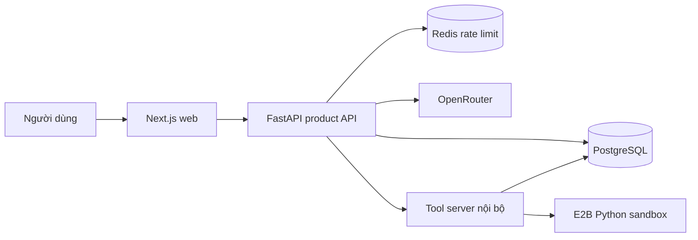

# Steam Game Data Demo

Ứng dụng web giúp người dùng khám phá metadata và đánh giá game Steam, xem dashboard thống kê và đặt câu hỏi phân tích dữ liệu bằng ngôn ngữ tự nhiên. Dự án kết hợp một hệ thống web có đăng nhập, phân quyền với AI Agent có thể truy vấn dữ liệu, tạo biểu đồ và chạy phân tích Python trong sandbox.

## Chức năng chính

- **Khám phá game:** tìm kiếm, lọc, sắp xếp, phân trang và xem đánh giá của từng game.
- **Dashboard:** tổng quan dữ liệu, game có nhiều review, phân bố thể loại, năm phát hành và ngôn ngữ hỗ trợ.
- **Trợ lý phân tích:** hội thoại nhiều lượt, tạo và mở lại phiên chat, theo dõi tiến trình, hủy tác vụ, xem biểu đồ được lưu.
- **Quản lý tài khoản:** đăng ký, đăng nhập, hồ sơ và bốn vai trò `viewer`, `analyst`, `scientist`, `admin`. Backend có API quản lý tài khoản và vai trò; giao diện admin hiện chủ yếu hiển thị danh sách người dùng.
- **Công cụ quản trị dữ liệu riêng:** `db_admin/` là ứng dụng Flask chạy nội bộ, kết nối trực tiếp PostgreSQL/Redis; khác với trang admin của website.

## Tổng quan hệ thống

Frontend dùng Next.js, TypeScript, Tailwind, Chart.js và Plotly. Backend dùng FastAPI và SQLAlchemy async. PostgreSQL lưu dữ liệu Steam, tài khoản, phiên chat, tác vụ và sự kiện. Redis phục vụ giới hạn tần suất request. OpenRouter cung cấp model; E2B thực thi Python do agent tạo trong môi trường riêng.

Product API mặc định chạy ở cổng `8000`; tool server ở `8001` và cần giữ trong mạng nội bộ. Hướng triển khai trong repository là frontend trên Vercel, backend trên VPS GCP, PostgreSQL trên Supabase và Redis trên Upstash. Đây là mô tả cấu hình và mã nguồn, không phải xác nhận các dịch vụ đang hoạt động trực tuyến.

## Phạm vi hiện tại

Luồng chat hiện tại là **Agent Harness** qua `/api/v1/agent-rpc`: lưu phiên và tác vụ trong PostgreSQL, gọi model và tool theo vòng lặp có giới hạn. Các route chat cũ được giữ để tương thích và mặc định tắt. Tool server triển khai tập con JSON-RPC `tools/list` và `tools/call`; chưa có đầy đủ vòng đời MCP để khẳng định tương thích mọi MCP client.

Dữ liệu là tập dữ liệu đã nạp vào database, không phải nguồn Steam được cập nhật trực tiếp theo thời gian thực. Số game/review phải lấy từ database đang sử dụng. Bộ lập lịch agent hiện hướng tới một API worker; khả năng chịu tải và chi phí cần được đo trên môi trường triển khai.

## Cấu trúc repository

| Thư mục | Nội dung |
|---|---|
| `back_end/` | Product API, Agent Harness, tool server, model dữ liệu, SQL và unit tests |
| `front_end/` | Giao diện web và client gọi API |
| `db_admin/` | Công cụ quản trị PostgreSQL/Redis nội bộ |
| `scripts/` | Khởi động local và kiểm thử trên Windows |
| `deploy/` | Cấu hình Nginx và script đồng bộ VPS cũ |
| `.github/workflows/` | Workflow kiểm thử và triển khai backend |
| `docs/` | Tài liệu theo chủ đề và hướng dẫn đọc |

## Bắt đầu

1. Đọc [cài đặt local](docs/guides/local-development.md), đặc biệt điều kiện schema database.
2. Chuẩn bị môi trường backend/frontend và cấu hình dịch vụ.
3. Từ thư mục gốc chạy `./scripts/start_local_stack.ps1` trên PowerShell.

Xem [mục lục tài liệu](docs/README.md) để tìm kiến trúc, API, schema, vận hành, kiểm thử và lộ trình học. [Bài nộp Agent Harness](docs/assessment/agent-track-submission.md) là tài liệu dành riêng cho đánh giá kỹ thuật.
